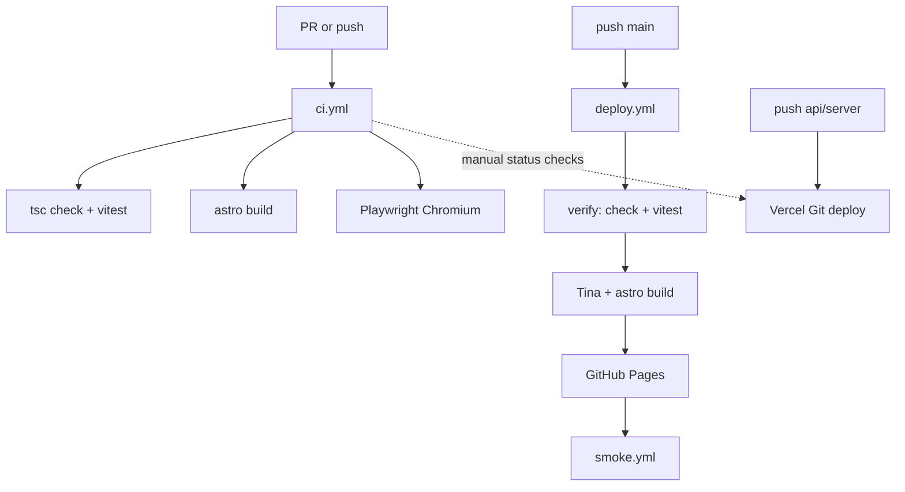

# Testing and CI — Corpoceleste

## Architecture

Corpoceleste is a split stack:

| Layer | Host | Role |
|-------|------|------|
| Astro + Tina static site | GitHub Pages | Shop UI, catalog, checkout page |
| Serverless APIs (`api/`, `server/`) | Vercel | Pricing, PayPal, Sendcloud, Resend, portal, stock |
| Orders / portal | Turso (libSQL) | Persistence |
| Stock source of truth | GitHub product markdown + `stock-ledger/` | Decrements after payment |

**Render is not used.**

Testing is three levels:

1. **Isolated (every PR / push)** — Vitest unit tests + `tsc -p tsconfig.ci.json` (`npm run check`) + Astro build + Playwright Chromium against a local preview. All external services mocked. No real payments, emails, or shipments.
2. **Scheduled / manual** — broader npm audit + Playwright Firefox/WebKit (`nightly.yml`).
3. **Post-deploy smoke** — non-destructive HTTP checks on `www.corpoceleste.eu` after a successful Pages deploy.



## Local commands

```bash
npm ci
npm run check          # tsc on server/api/lib/scripts/tests (CI gate)
npm run check:tina     # tinacms local build; fail if tina/tina-lock.json drifts
npm run check:astro    # full astro check (may report pre-existing page/Tina noise)
npm run test:unit      # vitest
npm run build:site     # astro build (no Tina cloud)
npx playwright install chromium
npm run test:e2e       # starts astro preview on :4321 unless E2E_BASE_URL is set
npm run ci             # check + unit + build:site
```

Against an already running preview:

```bash
E2E_BASE_URL=http://127.0.0.1:4321 npm run test:e2e
```

Multi-browser (local):

```bash
npx playwright install
PLAYWRIGHT_ALL_BROWSERS=1 npm run test:e2e
```

## What the unit suite covers

- Money / shipping floor / destination parsing / payment coverage — `server/order-pricing.ts`
- Full `priceOrderLines` with mocked catalog + Sendcloud (pickup €0, OOS, ignoreStock)
- Sendcloud quote selection (pure) — `server/sendcloud/quote-select.ts`
- PayPal line / SKU encoding — `src/lib/paypal-lines.ts`
- CAP / country allowlist — `src/lib/ship-normalize.ts`, `src/lib/ship-countries.ts`
- Stock markdown patch + ledger idempotency (`remainingStockLines`) — `server/stock-patch.ts`, `server/github-stock.ts`
- PayPal webhook: bad signature, underpay, duplicate done, happy path (all mocked) — `api/paypal-webhook.ts`
- Artist deal share math — `server/portal/math.ts`
- Sendcloud webhook HMAC — `server/sendcloud-webhook-handler.ts`
- Browser Origin / Sec-Fetch gate — `server/portal/http.ts`
- Checkout address completeness — `src/scripts/checkout-ship.ts`

## What E2E covers

- Home load (no fatal `pageerror`)
- Product → add to cart → checkout with CAP `24067`
- Shipping quote via **mocked** `/api/shipping-quote` (no Sendcloud)
- Pay box stays locked without address/terms
- Bonifico: locked without quote/data; amount due after quote; unlock only when complete
- Mobile viewport smoke on home

**Not automated:** real PayPal capture, Apple/Google Pay on device, Resend delivery, Sendcloud label creation, Turso writes, GitHub stock commits.

## GitHub Actions workflows

| Workflow | Trigger | Purpose |
|----------|---------|---------|
| `ci.yml` | PR, push, manual | check + unit + build + e2e + **Tina lock** + critical audit |
| `deploy.yml` | push `main`, manual | **verify** then Tina/astro build → Pages |
| `nightly.yml` | weekly Mon 04:17 UTC, manual | audit report + multi-browser e2e |
| `smoke.yml` | after successful Pages deploy, manual | live HTTP 200 + SEO tags (`title`/`meta`/canonical), `robots.txt`, sitemap, `llms.txt` |

Failed `verify` / CI jobs **block GitHub Pages** deploy when they run in `deploy.yml`.

## Environment variables

Unit/E2E CI needs **no production secrets**.

Optional local:

| Variable | Use |
|----------|-----|
| `E2E_BASE_URL` | Skip webServer; point Playwright at an existing site |
| `E2E_PORT` | Preview port (default 4321) |
| `PLAYWRIGHT_ALL_BROWSERS` | `1` = Chromium + Firefox + WebKit |
| `SITE_URL` / `VERCEL_ENV` | Used inside Origin gate unit tests via stubs |

## Secrets (names only — never commit values)

Existing deploy secrets (unchanged): `TINA_CLIENT_ID`, `TINA_TOKEN`.

Production API (Vercel, not required for CI tests): PayPal, Sendcloud, Resend, Turso, `GITHUB_TOKEN`, `CRON_SECRET`, webhook secrets, etc.

**Do not** put live PayPal/Sendcloud/Resend credentials into PR workflows.

## Sandbox guidance (future, not enabled in CI)

| Service | Notes |
|---------|-------|
| PayPal | Use official Sandbox apps + webhook simulator; gate behind `workflow_dispatch` + environment secrets |
| Sendcloud | Use test keys only; never call create-label in CI |
| Resend | Use test mode / sink inbox; never mail real customers from CI |

## Reports and debugging

- Vitest: terminal output; optional JUnit at `test-results/unit-junit.xml` in CI
- Playwright: `playwright-report/` HTML + `test-results/` traces on failure (CI artifacts, 7–14 days)
- GitHub Actions job summaries on CI/smoke

Reproduce a failed e2e locally:

```bash
npm run build:site
npx playwright install chromium
npm run test:e2e -- --trace on
npx playwright show-report
```

## Manual settings you should configure

### 1. Branch protection on `main` (required)

Without this, CI is advisory only — broken code can still land on `main`.

**Required status checks** (exact job names from `ci.yml`):

- `Unit + check`
- `Build site`
- `E2E Chromium`
- `Tina lock`

Options:

```bash
gh auth login
node scripts/apply-branch-protection.mjs
```

Or UI: **Settings → Branches → Add branch ruleset / classic protection** → pattern `main` →  
**Require status checks to pass** → enable the three names above → **Require branches to be up to date** (strict).

Notes:

- Checks appear in the picker only after `ci.yml` has run at least once on the repo.
- Prefer merging via PR so the required checks gate the merge; `deploy.yml` still runs its own `verify` before Pages.

2. **Vercel**: Actions cannot block Vercel’s Git integration by themselves. Options:
   - Enable “Ignored Build Step” / wait for a GitHub status check that maps to `ci.yml`, or
   - Only merge via PRs with required checks (practical default for this shop).
3. Confirm Pages Environment still uses the `github-pages` environment in `deploy.yml`.

## Known limitations

- Client cart prices are UX-only; server `priceOrderLines` is authoritative — E2E does not prove PayPal amount integrity (unit/integration with mocks do).
- Apple Pay / Google Pay require real devices/browsers and PayPal wallet eligibility.
- Webhook end-to-end against live providers is out of scope for PR CI.
- `npm audit` can surface transitive noise; CI fails only on **critical** production deps.
- Smoke tests do not validate checkout quote against live Sendcloud (would create operational coupling and flakiness).
